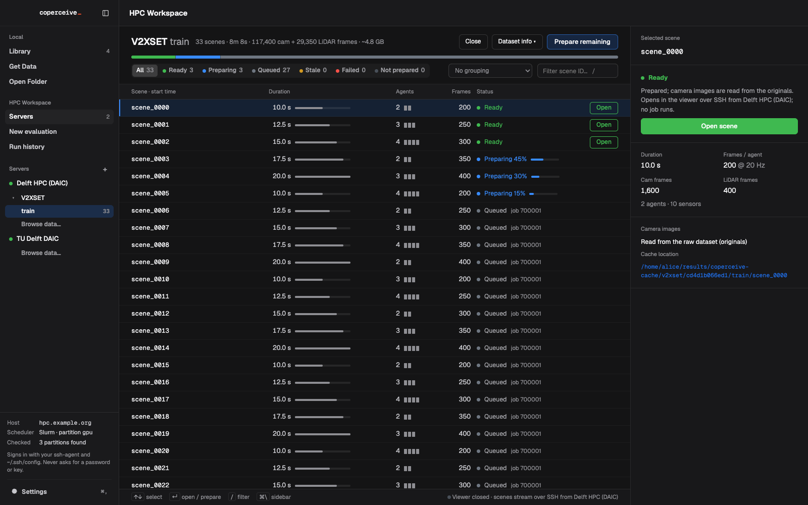

# Coperceive

A fast, native desktop application and multi-agent perception data library for collaborative autonomous driving research.



---

## Download

Get the latest release for your platform from [GitHub Releases](https://github.com/adarsh-nl/coperceive/releases/latest):

- **macOS Apple Silicon (arm64 `.dmg`)**: Available now in [v0.1.0](https://github.com/adarsh-nl/coperceive/releases/tag/v0.1.0).
- **Windows, Linux & Intel Mac**: Coming in **v0.1.1** (packaged installers and bundled Python runtimes merged).

*Note for Windows users:* Unsigned release builds trigger Windows SmartScreen on first run. Click **More info** → **Run anyway** to launch the installer.

---

## What It Does

- **Interactive 3D Scene Viewer**: Inspect multi-agent LiDAR point clouds, 3D bounding boxes, camera frustums, and agent trajectories with timestamped multi-agent playback.
- **Cluster Datasets over SSH**: Browse remote cluster directories, index dataset splits, and stream scenes directly over an SSH pipe with zero Slurm compute jobs required for viewing.
- **Parallel Slurm Array Preparation**: Prepare large cluster datasets into schema 1 formats using Slurm job arrays with IO-threaded cold reads and configurable filesystem budgets.
- **Camera Filmstrip & Projections**: Browse multi-agent camera feeds in a scrolling filmstrip, project LiDAR points onto camera images with depth coloring, and align CARLA OpenDRIVE HD road maps.
- **Local Library & Validation**: Organize local dataset roots, validate schema 1 scenes with automated synchronisation and geometry checks, and inspect dataset splits.
- **Privacy-Preserving Diagnostics**: Built-in crash detection and local diagnostics bundle with automatic redaction of tokens, private keys, hostnames, and user paths.

---

## Supported Datasets

| Dataset | Modalities | Agents | Licence Status | Status |
| :--- | :--- | :--- | :--- | :--- |
| **Griffin** | LiDAR, Camera, Poses | Drone + Vehicle | [MIT](https://github.com/wang-jh18-SVM/Griffin/blob/main/LICENSE.txt) | Supported |
| **OPV2V** | LiDAR, Camera, Poses, Boxes | Multi-Vehicle | See [dataset terms](https://mobility-lab.seas.ucla.edu/opv2v/) | Supported |
| **V2XSet** | LiDAR, Camera, Poses, Boxes | Vehicle + Infrastructure (RSU) | See [dataset terms](https://github.com/DerrickXuNu/v2x-vit) | Supported |
| **V2V4Real** | LiDAR, Poses, Boxes (LiDAR only) | Multi-Vehicle | See [dataset terms](https://github.com/ucla-mobility/V2V4Real) | Supported (LiDAR); visual orientation check pending |
| **DAIR-V2X-C** | LiDAR, Camera, Poses, Boxes | Vehicle + Infrastructure | See [dataset terms](https://github.com/AIR-THU/DAIR-V2X) | Adapter merged; not yet tested on real sensor data |

---

## Release Notes

### v0.1.1 (in development)
- **Windows & Linux platform behaviour**: Native window decorations on Windows and Linux, application menu with `Ctrl` shortcuts, dynamic reveal in file manager ("Show in Explorer", "Show in folder", "Show in Finder"), Windows OpenSSH support (`ControlMaster=no`), pause/resume for download jobs on Windows, strict ACL checks on credentials and state files, and pure Rust zip diagnostics export (#129).
- **Security & dependency updates**: Upgraded to Pillow 13.0.0 in `uv.lock` and tokio 1.54.1, restricted image decoding to PNG/JPEG, and dropped Python 3.10 support (minimum Python is 3.11) following Pillow 13's deprecation (#130). Note that the released v0.1.0 app already bundled Pillow 13.0.0.
- **Dataset adapters & detection**: Built-in adapters and directory detection for real-world V2V4Real (LiDAR-only test split, box angles in degrees `[roll, yaw, pitch]`, #126, #131) and DAIR-V2X-C cooperative formats (#126).
- **CARLA town road maps**: One-click download and alignment for CARLA OpenDRIVE HD road maps with package-verified (Town03, Town06, Town07, Town10HD) and matching public mirrors (not checked against the CARLA package: Town01, Town02, Town04, Town05) (#128).
- **Cross-platform desktop foundation**: Windows and Linux build configurations and headless smoke test pipelines in CI (#122).
- **Cross-platform diagnostics**: System log directories, app data paths, and clipboard integration abstracted across macOS, Windows, and Linux.
- **Hardened release packaging**: Strict asset packaging in release workflows and automated push CI triggers for `release/**` branches.
- *Full details: [CHANGELOG.md](CHANGELOG.md)*

### v0.1.0 (2026-11-05)
- **Native macOS desktop app**: Tauri-based desktop application with unified toolbar and redesigned layout.
- **Zero-Slurm-job viewing**: Read and stream prepared remote cluster scenes over a single SSH connection without running compute jobs.
- **Dense, calm UI overhaul**: Redesigned Library, Get Data, Servers, and Dataset View matching the design specification.
- **Camera filmstrip**: Multi-agent scrolling camera filmstrip with active-camera split view and depth-colored LiDAR point overlay.
- **Crash diagnostics**: Automated crash recording and user-initiated diagnostics dialog with strict secret redaction.
- *Full release: [v0.1.0 Release](https://github.com/adarsh-nl/coperceive/releases/tag/v0.1.0) · [CHANGELOG.md](CHANGELOG.md)*

---

## Quick Start

### Local Folder
Launch the local viewer server or drag a scene directory into the Coperceive desktop app:
```bash
# Start the local server
coperceive serve --root /path/to/scenes
```
Open `http://127.0.0.1:8731` in your browser, or open the Coperceive desktop application.

### HPC over SSH
1. In the desktop application, navigate to **Servers** (or **Settings → Servers**).
2. Add an SSH profile with your login host, username, and SSH identity file.
3. Browse remote directories, detect datasets, index splits, and stream scenes directly.

---

## Build from Source

### Prerequisites
- Python 3.11 to 3.13
- Node.js 20+ and npm
- Rust 1.80+ with Cargo

### Instructions
```bash
# 1. Clone repository
git clone https://github.com/adarsh-nl/coperceive.git
cd coperceive

# 2. Python environment & library
python3 -m venv .venv
source .venv/bin/activate
pip install -e ".[app,dev]"

# 3. Build web static assets
cd web
npm ci --legacy-peer-deps
cd ..
bash scripts/build_web_static.sh

# 4. Build desktop application
cd src-tauri
cargo build --release
```
The compiled application binary will be located in `src-tauri/target/release/`.

---

## Contributing

We welcome contributions! Please see [CONTRIBUTING.md](CONTRIBUTING.md) for setup guidelines and code standards, and review our [CODE_OF_CONDUCT.md](CODE_OF_CONDUCT.md) before participating.

To report security concerns, please see [SECURITY.md](SECURITY.md). For support channels and questions, see [SUPPORT.md](SUPPORT.md). For accessibility information, see [ACCESSIBILITY.md](ACCESSIBILITY.md).

---

## License

This project is licensed under the Apache-2.0 License. See [LICENSE](LICENSE) for details.

---

## Acknowledgements

Inspired by [py123d](https://github.com/kesai-labs/py123d) (Coperceive is a clean-room implementation).
