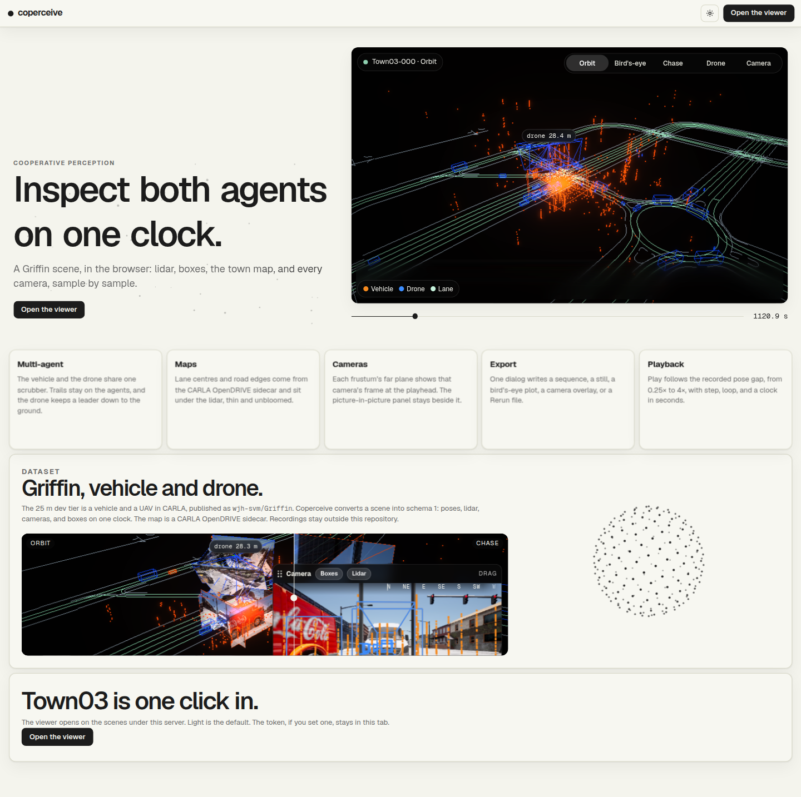
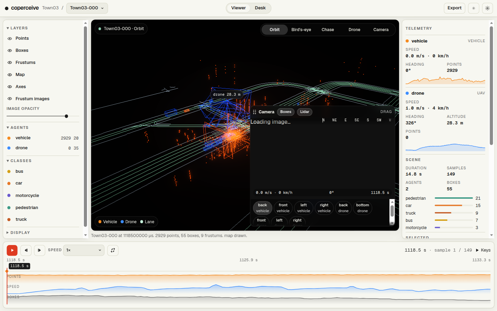
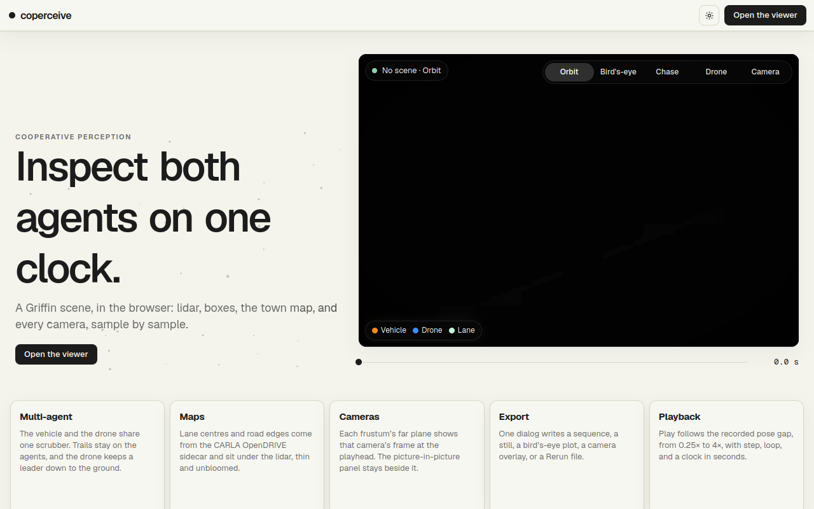

# coperceive

Version 0.1.0. A cooperative, multi-agent perception data library. Source: <https://github.com/adarsh-nl/coperceive>. The name is recorded in `docs/design/naming.md`.

The wheel ships the local page. `coperceive serve` binds `127.0.0.1` and requires `--root`. The desktop app in `desktop/` is a Tauri window around that same server. This tree does not train models.





Phase 1 is the scene model and the hybrid on-disk format. Phase 3 adds `Scene.at`, camera projection, cross-agent box queries, and `CooperativeDataset` in the `torch` extra. Phase 4 adds `coperceive validate`, which writes a JSON report and a Markdown report for a directory of schema 1 scenes. Phase 5 draws those scenes in the local page with three.js and can write a Rerun `.rrd`. A shared HD map per CARLA town is a sidecar next to those scenes. The contract a third party can implement is `docs/spec/format.md`.

## Install

Python 3.10–3.13.

```bash
python3 -m venv .venv
.venv/bin/pip install dist/coperceive-0.1.0-py3-none-any.whl
coperceive --version
coperceive serve --root /path/to/a/workdir
```

`coperceive serve` without `--root` exits. FastAPI, Uvicorn, and Pydantic are dependencies of the wheel, so the page starts from that install. From a checkout:

```bash
python3 -m venv .venv
.venv/bin/pip install -e ".[griffin]"
coperceive --help
```

Extras: `torch` (`coperceive.dataset.CooperativeDataset`; not imported by `coperceive`), `viewer` (rerun-sdk 0.22.1 and viser 0.2.23), `app` (the same server packages, kept so older install lines still work), `griffin`, `docs`, `dev`.

The licence is Apache-2.0 (`LICENSE`). Geist and Geist Mono, the faces on the page, are SIL Open Font License 1.1. Copyright 2024 The Geist Project Authors (<https://github.com/vercel/geist-font>). The text ships in the wheel:

- `coperceive/LICENSES/Geist-OFL.txt`
- `coperceive/LICENSES/GeistMono-OFL.txt`

Other notices are in `THIRD_PARTY_NOTICES.md`. The repository stays private. See `docs/adr/0006-licence.md`.

## Local page

```bash
coperceive serve --root /path/to/a/workdir --maps /path/to/maps
```

The default bind is `127.0.0.1:8731`. A non-loopback host requires `--token`. Behind a proxy, pass `--root-path` with the prefix the proxy adds.

The page in the wheel is the Vite build in `coperceive/app/static`. Rebuild it from `web/` with `npm run build` after a UI change. The Viewer tab lists scene directories under `--root`, plays recorded pose times, and can hide an agent. Viewpoints are orbit, bird's-eye, chase, drone, and a camera frustum. A strip under the transport shows each camera image for the current sample, with boxes and lidar projected onto it when those files exist beside the scene. Export Rerun writes `exports/<scene_id>.rrd` under that root and needs the `viewer` extra. Export sequence writes a camera MP4, GIF, or PNG sequence, and the page can also save the live 3D view. A view row toggles layers, colors, point size, box style, categories, and dark or light, and stores that in `localStorage` without the bearer token. The same exports from a terminal:

```bash
coperceive export rerun /path/scene --out /path/scene.rrd
coperceive export sequence /path/scene --out /path/front.mp4 --agent vehicle --sensor front
```

The page talks to the server only over HTTP. `coperceive.viewdata` does not import FastAPI or Rerun. Lane centres and road edges are drawn under the lidar when `--maps` resolves the scene's `map_name`.

## Desktop

The shell is `desktop/`. It is the plan in `docs/adr/0007-desktop.md`. A Tauri window starts the PyInstaller sidecar `coperceive-server` as:

```text
coperceive-server serve --host 127.0.0.1 --port <chosen> --token <generated> --root <app data>
```

The token is written to `sessionStorage` under `coperceive-token` before the first request. It is not placed in the URL. The window loads `http://127.0.0.1:<port>/`. Closing the window stops the server. The same `coperceive` command from a terminal is unchanged.



Build the Linux AppImage and deb from a checkout that already has the page in `coperceive/app/static`:

```bash
pip install . pyinstaller
python desktop/build_sidecar.py
cd desktop && npm install && npx tauri build --bundles appimage,deb
```

The pull-request workflow builds those two Linux bundles. `.github/workflows/release.yml` builds the wheel, the sdist, the Linux bundles, and the macOS and Windows bundles when a `v*` tag is pushed. That workflow uploads artifacts only. It does not publish to PyPI and it does not create a GitHub Release.

## Griffin

```bash
coperceive download griffin --subset 25m --preset dev --dest /path/outside/the/repo --dry-run
coperceive convert griffin --subset 25m --raw-root /path/griffin-release --out /path/scenes
```

`--preset dev` is drone metadata, vehicle metadata, and vehicle LiDAR. Camera archives are selected only with `--components`. The download needs the `griffin` extra, checks the MIT card and toolkit licence, and writes outside the git checkout. Recordings are not committed. Conventions are in `docs/datasets/griffin.md`. Earlier measurements are in `docs/design/griffin-verification.md`.

## Validate

```bash
coperceive validate /path/scenes --json report.json --markdown report.md
```

The report covers time sync, UAV height above the vehicle, pose speed and acceleration, shared-track and nearest-centre box agreement, coverage, scene and frame counts, and, when a maps root is present, the distance from vehicle poses to the driving-lane centre. The centreline block is a measurement. It does not fail the run. The default exit is 0 once both files exist. `--strict` exits 1 on a hard failure: an unreadable scene, a missing frame, or a cross-agent pose miss. Speed and acceleration are warnings. A missing directory exits 2. The Griffin-25m figures are in `docs/validate.md`.

## Maps

```bash
coperceive maps fetch --dest /path/outside/the/repo
coperceive maps ingest --xodr /path/Town03.xodr --map-name Carla/Maps/Town03 --out /path/maps
coperceive maps align --maps /path/maps --scenes /path/scenes
```

`fetch` extracts Town03, Town06, Town07, and Town10HD from the CARLA 0.9.15 package. The OpenDRIVE bytes are not committed. The sidecar layout and the Griffin-25m residuals are in `docs/adr/0008-hd-map.md`.

## Tests

```bash
.venv/bin/pip install -e ".[app,griffin,dev]"
.venv/bin/ruff check .
.venv/bin/ruff format --check .
.venv/bin/pyright
.venv/bin/pytest
```

## Docs

```bash
.venv/bin/pip install -e ".[docs]"
.venv/bin/mkdocs serve
```

Design notes live in `docs/`. Current state and open decisions are in `HANDOVER.md`.
