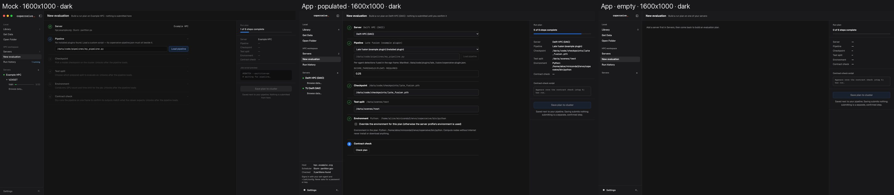

# Evaluate predictions

Put a model's boxes beside schema 1 scenes, match them to the ground truth, and read the table. The screenshot is the evaluation page with synthetic fixtures.



## Steps

1. Import boxes. `coperceive predictions import` writes `run.json` and one `boxes.parquet` per scene. `--score-note` is required:

    ```bash
    coperceive predictions import boxes.jsonl --run det-v1 --root /data/demo/scenes \
      --score-note "sigmoid of the class logit"
    ```

2. Match and report:

    ```bash
    coperceive eval run det-v1 --root /data/demo/scenes
    coperceive eval report det-v1 --root /data/demo/scenes
    ```

3. Compare two to four run ids with `coperceive eval compare`. The help text says two runs keep the b − a table.

The demo's own run id is `demo` after `coperceive demo create`. That run is labelled as a simulated detector in the generator, not as a trained model.

## More detail

- [Evaluate](../eval.md)
- [Predictions](../spec/predictions.md)
- [Evaluation decision](../adr/0010-eval-predictions.md)
