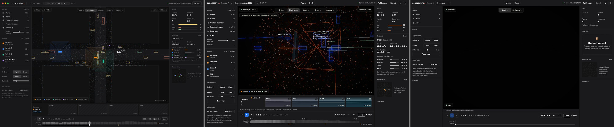

# View a scene

Open one schema 1 scene in the app or in the local page. The screenshot is the scene viewer with synthetic fixtures, not a real dataset frame.



## Steps

1. Produce a scene directory. The demo is `coperceive demo create /data/demo`, which writes `/data/demo/scenes/demo-junction`.
2. Start the page with the parent of the scene directories:

    ```bash
    coperceive serve --root /data/demo/scenes
    ```

3. Open `http://127.0.0.1:8731/`. The default host and port are in `coperceive serve --help`.

In the desktop app, open the scene from the library after **Open the demo** or **Open Folder**.

## More detail

- [Viewer](../viewer.md)
- [On-disk format](../spec/format.md)
- [Demo](../datasets/demo.md)
