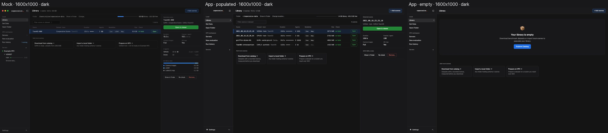

# What Coperceive is

Coperceive is a desktop application and a Python library for cooperative multi-agent perception data. It views a scene, scores prediction runs, and opens a dataset on this machine or on a cluster.

The library page below is a screenshot of the app with synthetic fixtures. It is not a frame from a real dataset.

| | |
| --- | --- |
| Install | [macOS, Windows, and Linux builds](get-started/install.md) |
| First scene | [Quick start](get-started/quick-start.md) with the synthetic demo |
| Where the files live | [Local folder or a cluster](get-started/local-and-cluster.md) |
| Data it reads | [Datasets](datasets/index.md) |

The project repository is [adarsh-nl/coperceive](https://github.com/adarsh-nl/coperceive). The licence of this project is Apache-2.0.

## More detail

- [On-disk format](spec/format.md)
- [Design decisions](notes/decisions.md)
